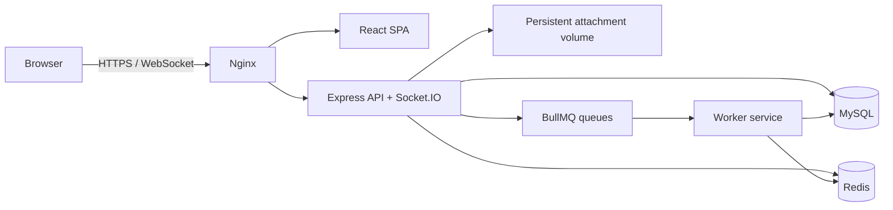

# DevFlow

DevFlow is a multi-tenant developer collaboration platform for organizations, projects, issues, activity, notifications, AI assistance, and attachments.

## In two minutes

DevFlow is a portfolio-grade full-stack issue-management system: React/Vite on the front end; Express, Prisma/MySQL, Redis, BullMQ, and Socket.IO on the back end. It demonstrates tenant-scoped RBAC, rotating sessions, dashboards, issue workflows, async AI assistance, and secure attachment handling. Start with the Docker quick start below, then log in using the local seed accounts printed by `pnpm db:seed`.

**Implemented:** core collaboration workflows, tenant isolation, dashboards/activity, attachments, Redis caching/rate limits, queues, AI abstraction, Docker/CI assets.

**Tested:** API authorization/isolation/authentication and Socket.IO tests, worker and web unit tests, lint/typecheck/build commands.

**Optional:** OpenAI integration and S3 storage require environment configuration.

**Future improvement:** committed Prisma migrations, TLS ingress, browser E2E tests, and multi-instance Socket.IO support. See [the final architecture review](docs/final-architecture-review.md).

## Architecture



## Quick start: Docker

1. Copy the configuration and set strong unique passwords/secrets:

   ```sh
   cp .env.example .env
   ```

2. Build and start the private MySQL/Redis/API/worker services and the public reverse proxy:

   ```sh
   docker compose up -d --build
   ```

3. Apply the schema once the database is healthy, then optionally seed local demo data:

   ```sh
   docker compose exec api npx prisma db push --schema=prisma/schema.prisma
   docker compose exec api npx prisma db seed
   ```

4. Open `http://localhost:8080`. Only Nginx is publicly published; MySQL, Redis, API, and worker remain on the internal Docker network.

Useful commands:

```sh
docker compose ps
docker compose logs -f api worker
docker compose down                 # keeps named volumes
docker compose down -v              # deletes database, Redis, and uploads
```

## Local development

Requirements: Node 20+, pnpm 8+, MySQL 8, and Redis 7. XAMPP MySQL can be used in place of Docker MySQL.

```sh
pnpm install
cp .env.example .env
pnpm db:generate
pnpm db:push
pnpm db:seed
pnpm dev
```

The web app runs at port 5173, API at 4000, and the worker consumes queues separately. `pnpm db:push` is for local development; production deployments should use reviewed Prisma migrations (`pnpm db:migrate`) once migrations are committed.

## Verification

```sh
pnpm lint
pnpm typecheck
pnpm test
pnpm build
```

The PR workflow runs install, Prisma generation, lint, typecheck, tests, and builds. The production workflow only runs from `main`, builds artifacts, and deploys only when GitHub environment secrets (`DEPLOY_HOST`, `DEPLOY_USER`, `DEPLOY_SSH_KEY`) plus deployment variables are configured.

## HTTP API

All API routes are rooted at `/api/v1`.

| Area | Representative routes |
|---|---|
| Authentication | `POST /auth/register`, `/auth/verify-email`, `/auth/resend-verification`, `/auth/login`, `/auth/refresh`, `/auth/logout`, `GET /auth/me` |
| Organizations | `GET/POST /organizations`, member/invitation management under `/organizations/:organizationId` |
| Projects | `GET/POST /organizations/:organizationId/projects`, `GET/PATCH/DELETE /projects/:projectId` |
| Issues | `GET/POST /projects/:projectId/issues`, `GET/PATCH /projects/:projectId/issues/:issueId`, comments below each issue |
| Attachments | list/upload/download/delete under `/projects/:projectId/issues/:issueId/attachments` |
| Dashboard/audit | `/organizations/:organizationId/dashboard`, `/organizations/:organizationId/activity`, `/projects/:projectId/activity` |
| Notifications | `/notifications`, `/notifications/unread-count` |
| Health | `/health/live`, `/health/ready` |

## Security and tenancy

- Access tokens are short-lived and held in browser memory. Refresh tokens are HTTP-only cookies, hash-backed by `Session`, and rotated on refresh.
- Organization and project RBAC is enforced server-side on every protected route. Organization IDs are never trusted from the client without membership validation.
- Prisma parameterizes database operations, avoiding SQL-string interpolation. Zod validates request bodies and pagination/filter values.
- Helmet, strict CORS origin configuration, correlation IDs, structured logs, and Redis-backed rate limiting protect the HTTP layer.
- Attachments have MIME/extension/size allow-lists, opaque storage keys, metadata-only database records, and authorization checks before list, download, or deletion.
- Do not place API keys, passwords, JWT secrets, or production database URLs in Git. Use `.env` locally and GitHub/Docker platform secrets in production.

## RBAC

Organization roles: `OWNER`, `ADMIN`, `MANAGER`, `DEVELOPER`, `VIEWER`. Project roles: `LEAD`, `MEMBER`, `VIEWER`; organization owners/admins have implicit project lead access. Read operations require viewer access; mutations require member/lead access as appropriate.

## Redis, queues, Socket.IO, AI, storage

- Redis backs caching, rate limiting, and BullMQ.
- Email, notifications, AI, reports, and cleanup are queue namespaces. The worker runs email, notification, cleanup, and AI processors.
- New accounts must verify a six-digit email OTP before login. The default provider logs messages for development; configure Resend through `EMAIL_PROVIDER`, `RESEND_API_KEY`, and `EMAIL_FROM` for real delivery.
- Socket.IO authenticates with the bearer token and authorizes organization/project/issue room joins before membership.
- AI is optional (`AI_ENABLED=false` by default). Keys remain server-side. AI work is queued, has timeouts/failure recording, and stores metadata for auditing.
- Local attachment storage is persisted as the `attachment_data` Docker volume. S3 is behind a provider interface and is intentionally not enabled until credentials and SDK implementation are supplied.

## Environment variables

See `.env.example` for the complete documented set. Required in production: `MYSQL_PASSWORD`, `MYSQL_ROOT_PASSWORD`, `JWT_ACCESS_SECRET`, `JWT_REFRESH_SECRET`, and an explicit `CORS_ORIGIN`. `OPENAI_API_KEY` is only required when AI is enabled.
