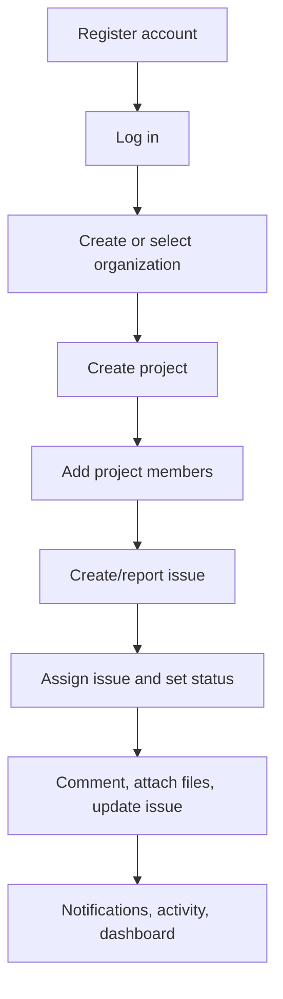
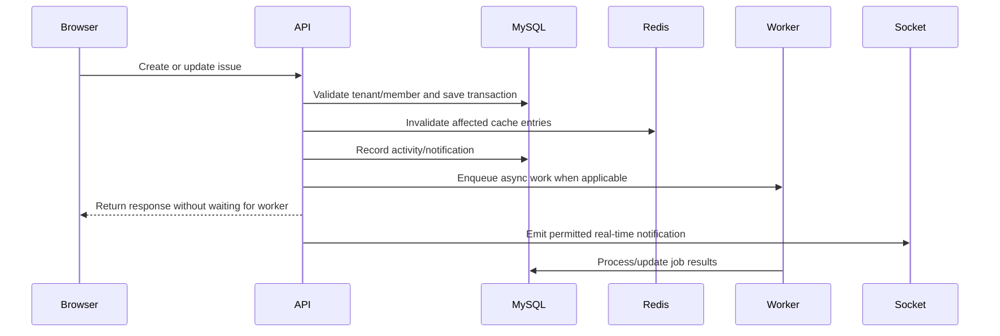

# DevFlow workflow guide

## What DevFlow does

DevFlow is a multi-tenant collaboration and issue-management platform. Each client creates an account, creates or joins an organization, manages projects inside that organization, and collaborates on issues without seeing another organization’s data.

The application combines:

- Accounts, login, refresh sessions, and logout
- Organization and project role-based access control
- Issue reporting, assignment, status tracking, comments, labels, and attachments
- Dashboards, activity/audit history, and notifications
- Redis caching/rate limiting, BullMQ background work, real-time Socket.IO events, and optional AI assistance

## Roles and access

Every user must be authenticated before accessing protected data.

Organization roles:

| Role | Typical responsibility |
|---|---|
| `OWNER` | Owns the organization and has full administrative access. |
| `ADMIN` | Manages organization resources and has implicit lead access to projects. |
| `MANAGER` | Coordinates organization work according to configured API permissions. |
| `DEVELOPER` | Participates in organization projects. |
| `VIEWER` | Has read-only organization access. |

Project roles:

| Role | Typical responsibility |
|---|---|
| `LEAD` | Manages a project, its settings, and project members. |
| `MEMBER` | Creates and updates issues, comments, and attachments. |
| `VIEWER` | Views project, issues, activity, and attachments. |

Organization owners and admins are treated as project leads for projects in their organization. Every server route verifies organization/project membership; changing a URL or ID in the browser cannot grant access to another tenant.

## Client journey

## 1. Create an account

1. Open the registration page.
2. Enter a name, email address, and password that meets the form requirements.
3. Submit the form.
4. Log in with the new credentials.

On login, DevFlow returns a short-lived access token used by the browser for API requests. It also sets a secure HTTP-only refresh-token cookie. Refresh tokens are stored as hashes in database sessions and rotate when refreshed. The user can log out from the current device or revoke all sessions.

## 2. Create or select an organization

An organization is the tenant boundary: projects, issues, labels, activity, notifications, and members belong to it.

To create one:

1. Go to **Organizations**.
2. Select **Create Organization**.
3. Provide a display name and unique URL-style slug.
4. Select the organization as the active workspace.

The creator becomes the organization owner. A user can belong to more than one organization, but data is always resolved using the active organization and server-side membership validation.

## 3. Invite and manage organization members

An organization owner/admin can open the organization member page and send an invitation with an organization role.

Typical flow:

1. Open **Organization Members**.
2. Enter the colleague’s email and select their role.
3. Send the invitation.
4. The invited user accepts it and becomes an organization member.
5. Owners/admins can update roles or remove members when needed.

Invitation-related emails are designed to run asynchronously through the email queue, so the browser request does not wait for delivery.

## 4. Create a project

Projects organize work inside an organization.

1. Select the organization workspace.
2. Open **Projects** and choose **Create Project**.
3. Provide a project name, a short uppercase key such as `WEB`, and an optional description.
4. Create the project.

The project key is used to generate readable issue IDs, for example `WEB-12`. Project listings and details can be cached in Redis, scoped by organization and filters. Project or issue changes invalidate the relevant cache entries.

## 5. Add project members

Organization membership alone does not normally give a user project access. A project lead can add organization members to a project and give them one of these roles:

- `LEAD`: manages project members and project settings.
- `MEMBER`: performs normal issue work.
- `VIEWER`: sees project information but cannot change issues.

Owners and admins retain implicit project-lead access within their organization.

## 6. Create or report an issue

From a project’s issue board:

1. Choose **Create Issue**.
2. Enter a title and optional description.
3. Select type (`BUG`, `TASK`, `FEATURE`, or `IMPROVEMENT`).
4. Choose priority and initial status.
5. Optionally set a due date, labels, and an assignee.
6. Submit the issue.

The server increments the project issue sequence inside a database transaction and creates an identifier such as `WEB-12`. It validates that selected labels belong to the same organization and that an assignee is a permitted project/organization member. This prevents cross-tenant labels and assignments.

## 7. Assign work and update an issue

Project members/leads can update an issue from the issue board or detail view.

They can change:

- Title and description
- Type and priority
- Status: backlog, to-do, in progress, in review, done, or cancelled
- Assignee
- Due date
- Labels

When someone is assigned, DevFlow creates an in-app notification. The user’s private Socket.IO room can receive the notification in real time. Updates also produce organization/project activity entries and use optimistic version checking to avoid silently overwriting a newer update.

## 8. Comments and attachments

Project members can comment on issues to provide decisions, status updates, implementation notes, or questions. Comments become part of the issue’s activity trail.

Members can upload approved file types such as images, PDFs, text files, Markdown, and ZIP files (subject to configured size/type limits). DevFlow stores only metadata in MySQL; file bytes are placed in the configured storage provider. Downloads and deletion always verify that the requester has access to the issue’s project and organization.

## 9. Dashboard, activity, and notifications

Organization dashboards calculate aggregates in the API/database rather than in the browser, including:

- Total, open, completed, assigned, and unassigned issues
- Issues grouped by status, priority, and type
- Recent organization activity

The organization activity page provides audit-style history with filtering and pagination. The project activity page narrows this history to a project. Notifications show assignment and other relevant events for the current user.

## 10. Optional AI assistance

AI is optional and disabled unless configured by the deployment administrator. It can summarize issues, suggest acceptance criteria, classify an issue, and identify possible duplicates.

AI work is queued to BullMQ and processed by the worker. Normal issue creation never waits for AI. The API key remains on the server; AI responses are stored as assistance/audit data and should be reviewed by people before acting on them.

## Behind the scenes

## Safety and operational behavior

- Request bodies and issue filters are validated before database queries.
- Prisma parameterizes database access.
- Authentication routes and API routes are rate-limited with Redis when Redis is available.
- Cache failures fail open: users receive fresh database data rather than an outage.
- Cache keys include tenant identity; cache invalidation is awaited after project/issue changes.
- Background jobs use retry/backoff configuration and structured job logging.
- Production requires strong environment secrets, HTTPS/TLS at the deployment edge, reviewed database migrations, backups, and monitoring.

## Helpful local test path

After starting MySQL and Redis and running the setup in `README.md`:

1. Register a user or use a seeded account.
2. Log in.
3. Create an organization.
4. Create a project.
5. Open the issue board and create an issue.
6. Assign it to a project member, move its status, add a comment, and upload a permitted attachment.
7. Open dashboard/activity/notifications to observe the resulting records.
